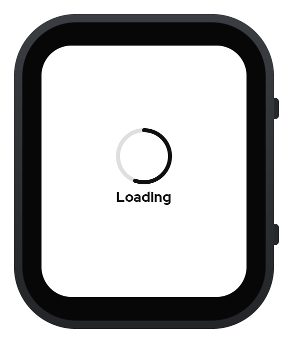
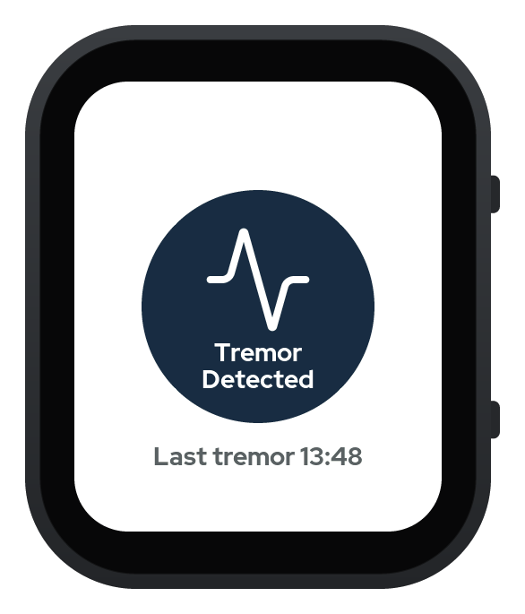
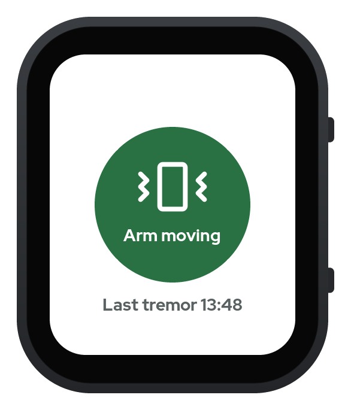
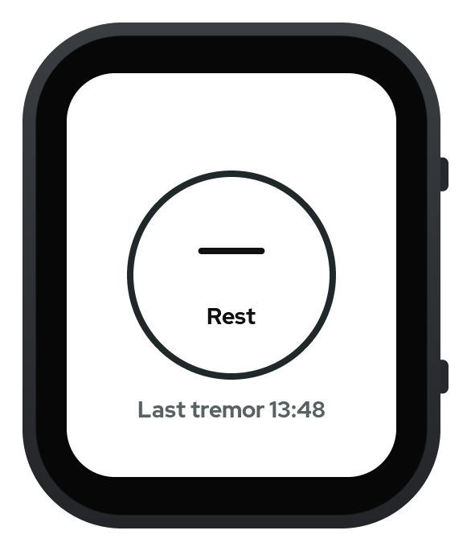
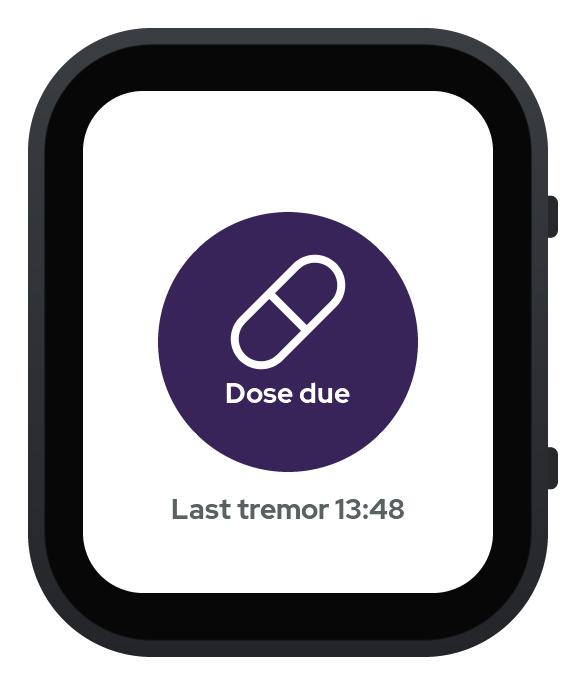
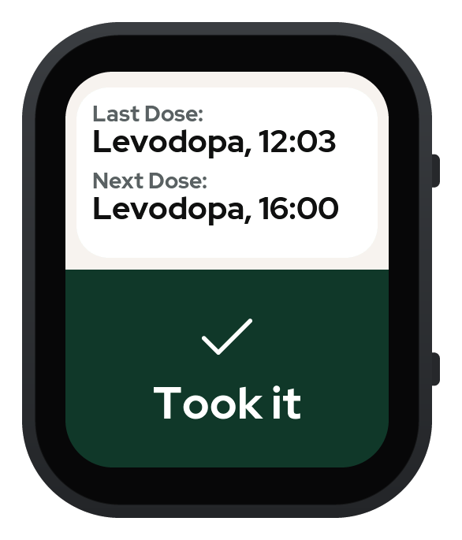
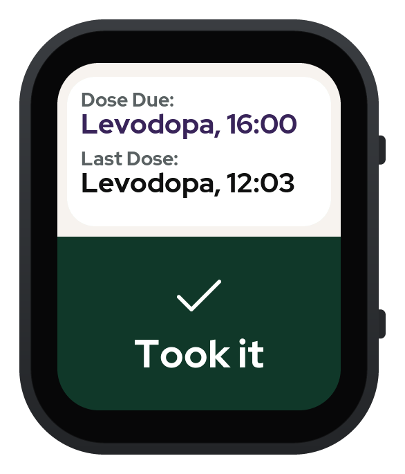
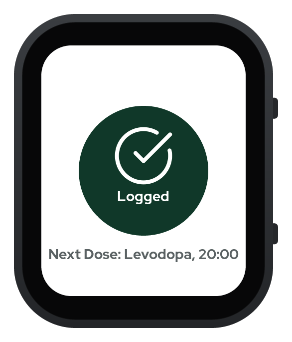
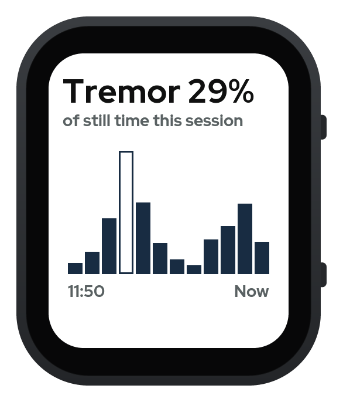
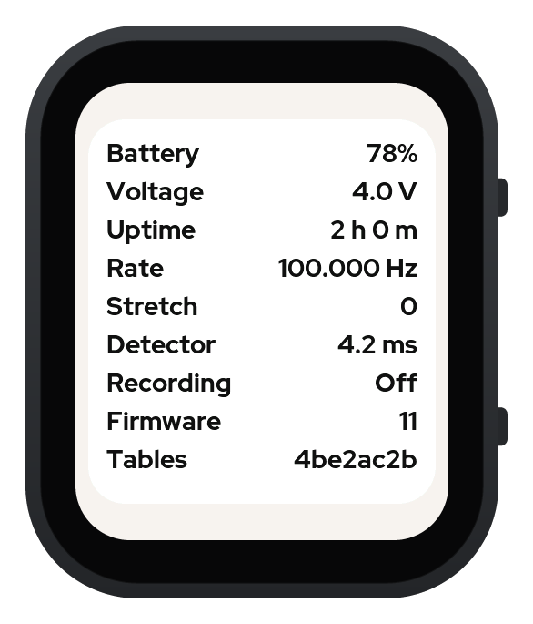

# Tremor log

Tremor log runs a published Parkinson's tremor detector on a watch by itself. Every second the watch runs a C port of the ParaDigMa 1.1.2 tremor detector on the last 4 seconds of gyroscope readings, and the face shows what it found. The face is designed for a person with Parkinson's who wears the watch on the more affected wrist, though nobody with Parkinson's has used it yet. The watch also reminds the wearer of dose times and logs a dose with one tap.

**This is not a medical device.** It is not for diagnosis or treatment, and it gives no basis for dose decisions. Do not rely on its dose reminders.

This is a portfolio project. The detector is used as published and is never retrained. It has been checked on public recordings and on the watch lying on a table. It has not been tested on a person with tremor, and the wrist tests are still to come.

## The face

These screenshots were drawn on the laptop with `firmware/main/face_draw.c` and LVGL 9.5 from a made-up session, then placed in a drawing of the watch case at its real scale.

### Home

The circle shows the latest state. Home keeps the time of the last tremor under it once one has been recorded.

<table>
  <tr>
    <td align="center"><br>Loading</td>
    <td align="center"><br>Tremor</td>
    <td align="center"><br>Arm moving</td>
  </tr>
  <tr>
    <td align="center"><br>Rest</td>
    <td align="center"><br>Dose due</td>
    <td></td>
  </tr>
</table>

Loading shows with a turning spinner while the detector has no answer yet, such as at the start of a session or after a gap in the readings. Arm moving means the arm moved too much for the detector to judge. Rest means the arm was still and showed no tremor.

### Medication

A tap anywhere on Home opens Medication. The lower half is one large "Took it" button. A tap logs the dose and shows Logged for three seconds, then the face returns to Home. When a dose is due, the next dose line turns purple.

<table>
  <tr>
    <td align="center"><br>Medication</td>
    <td align="center"><br>Dose due</td>
    <td align="center"><br>Logged</td>
  </tr>
</table>

### Session and Status

Session shows the share of still time with tremor in this session. Each bar below it covers 10 minutes, with the oldest bar's start time on the left and now on the right, and a hollow bar had under two minutes of still time. Status shows the battery charge and voltage and the time since the watch started. For the last answer it shows the sensor rate, the number of the time rule's stretch, and how long the detector took. Recording reads On while a laptop is taking the watch's lines. The last two rows give the firmware version and the start of the detector tables' hash. Both screens use a plain white background.

<table>
  <tr>
    <td align="center"><br>Session</td>
    <td align="center"><br>Status</td>
  </tr>
</table>

The BOOT button cycles through the screens. Every tap target covers at least a third of the screen, and the face uses no swipes or long presses.


## How it works

The watch is a Waveshare ESP32-S3-Touch-AMOLED-2.06. Its QMI8658 gyroscope gives about 114 readings a second in bursts of 11, and the sensor task stamps each burst in an interrupt. The time rule gives each reading a time, with a rate measured from the burst stamps of the first 10 seconds. The converter then resamples the readings to 100 a second with a cubic spline, as the ParaDigMa toolbox does. The C detector follows `reference/plain_detector.py` step for step in 32-bit floats. It adds its sums in the order numpy uses and scores each window in 64-bit doubles.

Five FreeRTOS tasks share the work, and each part of the state has one owning task.

```
QMI8658 --INT1--> sensor task --> pipeline task ----> state task -----> screen task
  114 Hz FIFO     time rule       converter,          face state,       LVGL face
                                  detector            share, doses
                       each task's lines --> usb task --> laptop recording
```

When a laptop is plugged in over USB, the watch writes every reading and every answer to it as text. `core/replay.c` runs the same C code on the laptop from the saved readings, and `tools/compare_session.py` fails the run if any window's answer differs from the watch, or its probability by more than 1e-6. It also runs the Python toolbox on every fourth window and reports how often its answers agree with the watch, with no pass limit.

## Results

| Check | Result | Evidence |
| --- | --- | --- |
| C detector against the toolbox, built on the laptop | All 26,264 windows of the 10,318 PADS recordings (469 people, 11 tasks, both wrists). No answer differs, and the largest difference in the tremor probability is 5.63e-07. | `tests/pads/pads_match.md` |
| C detector on the chip | 322 saved windows, including windows close to each cut-off. No answer differs, and the largest probability difference is 2.66e-07. | `tests/firmware/chip_windows_report.md` |
| Detector run time on the chip | About 6.6 ms a window, with the 64-bit scoring step done in software | `specs/tech-stack.md` |
| Wait for an answer | About 113 ms after a window's last 100 Hz sample | `specs/tech-stack.md` |
| Watch against replay | Three committed table recordings with 1797, 1256, and 65 compared windows. Every compared window agrees, and the largest probability difference is 2.52e-10. | `tests/firmware/record_session.md` |
| 30-minute table run | 1796 answers, one each second, with no lost readings | `tests/firmware/pipeline_report.md` |

In PADS the toolbox fires on about 4 percent of the Relaxed task's windows for healthy people and about 23 percent for people with Parkinson's (`reference/results/pads_counts.md`). PADS does not say when tremor was present, so these shares are not hit rates.

## Limitations

- The dose clock lives in memory only. After each restart the face shows dashes and gives no dose reminders until the laptop sends the clock again. The board's clock chip is not used.
- The battery has not been checked. The power chip reported no battery in every run, and the watch has only run on USB power.
- The detector is tuned against false alarms, so it undercounts tremor by design. It also judges only still time, so tremor while the arm moves is not counted.
- On input with no noise at all, such as a stuck sensor, the 32-bit port and the 64-bit toolbox can give very different probabilities. In 4,800 such test windows the final tremor answer never differed, and on every real recording checked so far the two agree.
- When the time rule ends a stretch, the face shows Loading for about 6 seconds. Table runs gave about one such end an hour, because the sensor's own rate drifts by a few parts per million.

## Repo layout

| Folder | What it holds |
| --- | --- |
| `core/` | The shared C library: the detector, the converter, the state rules, and the replay program. It builds on the laptop and on the watch. |
| `firmware/` | The ESP-IDF project for the watch. `firmware/main/` holds the five tasks and the face. `firmware/detector_check/` runs the saved windows on the chip, `firmware/bringup/` measured the sensor rate, and `firmware/components/` holds XPowersLib for the power chip. |
| `reference/` | The Python toolbox that the C port must match, and the PADS results. |
| `viewer/` | The recording viewer, a small Electron app that shows a saved recording. It can also record from the watch through `tools/watch_cli.py`. |
| `tools/` | Generators for the detector tables and face assets, the watch command tool, the session check, and the EDF+ export. |
| `tests/` | The C unit tests, the Python checks, and the logs and reports from the watch. |
| `specs/`, `context/` | The mission, tech stack, roadmap, build spec, and face design. |

The full ESP-IDF settings files (`sdkconfig`) are committed next to `sdkconfig.defaults`, so a build uses exactly the settings that were tested.

## Build and check

`make check` builds `core/` and runs the C unit tests, checks the model file's hash, runs the recording viewer's unit tests, and builds the firmware. The firmware needs ESP-IDF v6.1. `make python` runs the Python tests, which need the toolbox venv that `reference/README.md` sets up, and `make full` runs both. None of them needs the watch or the PADS download.

To flash the watch, with the port it shows up on:

```
idf.py -C firmware -p /dev/cu.usbmodem101 flash
```

To record a session from the watch and check it against the toolbox, after the C build:

```
~/.espressif/tools/python/v6.1/venv/bin/python tools/watch_cli.py record --out session.txt.gz --minutes 60
reference/.venv/bin/python tools/compare_session.py session.txt.gz --report report.md
```

## View a recording

`viewer/` holds a small Electron app that plots a saved recording's gyroscope readings against time and marks each stretch where the watch answered tremor. A Summary card at the right of the chart gives the file name and the boot's facts in two groups, Recording and Data quality. In a narrow window it sits under the chart. When the file holds more than one boot, a list above the chart picks the boot. It needs Node 22, and the install needs the network once.

```
make viewer-start FILE=session.txt.gz
```

`make viewer-start` installs the packages with `npm --prefix viewer ci` when they are missing or out of date, and then runs `npm --prefix viewer start`. Add `BOOT=ID` to open one boot of the file. With no FILE the app opens empty. `make viewer-smoke` runs the app in capture mode on the test recordings and checks each drawing.

File > Open (Cmd+O) opens another recording. The x, y, and z chips show or hide each axis, and the layout control picks Overlaid, one plot of all axes, or Stacked, one plot for each axis. The stacked plots share one scale, so their y labels match, and each names its axis at its left. In every plot, a light grey shade covers each tremor episode, and black vertical lines with no text mark where it starts and ends. Tremor windows that overlap or touch join into one episode. Move the pointer over a plot to read the time, the three values, and the answer at that point. The time span control above the plot shows 10 seconds, 30 seconds, 1 minute, or the whole boot. A span as long as the boot or longer is turned off, since it would show the whole boot. The Earlier button moves the view back by half its width. Drag across a plot to zoom in, double click to show the whole boot, and use the left and right arrow keys to move the view. Every plot shares the view.

The page follows the Mac's light or dark setting. `--theme light` or `--theme dark` after `npm --prefix viewer start --` fixes the theme, and `--layout stacked` opens the file in the stacked layout. `make viewer` runs the viewer's unit tests, which need no install.

The Record button runs `tools/watch_cli.py record`, which resets the watch and saves every line it writes. Press Stop to end the recording, as Ctrl-C does, and the viewer opens the new file. The viewer never opens the watch's port itself. Files go to `recordings/` at the repo root, which git leaves out, with names such as `tremor-2026-10-28-143005.txt.gz`, and a name that is taken gets `-2`. `TREMOR_RECORDINGS` names another folder, and `TREMOR_PYTHON` names the Python to run, which must hold pyserial and is the ESP-IDF Python by default. When the recording cannot start or saves no file, such as when no watch is plugged in, a red notice under the header says why, and the plot stays as it was. When watch_cli.py stops with an error after it saved a file, the viewer still opens that file, and the notice gives the error.

## Export a recording as EDF+

`tools/export_edf.py` writes a saved recording as EDF+ files that other biosignal programs can open. It reads saved files only and never opens the watch's port. Run it from the repo root after the C build.

```
reference/.venv/bin/python tools/export_edf.py session.txt.gz [--out-dir DIR] [--boot ID]
make edf FILE=session.txt.gz [OUT_DIR=DIR] [BOOT=ID]
```

It writes one file for each boot, named after the recording and the boot ID, so `session.txt.gz` with boot 2565193163 gives `session_2565193163.edf` beside the recording or in DIR. It never writes over a file. Each file holds the 100 Hz gyroscope samples that the detector used, in degrees per second, with each window's answer, each face change, each dose, and each stretch start as annotations. The boot's clock gives the start date and time, and a boot with no clock gets the EDF+ placeholders. A gap between stretches stays a gap, so such a file is discontinuous EDF+D.

EDFbrowser and edfio keep the gaps. MNE-Python 1.13.2 places the data records of an EDF+D file back to back, so its times after a gap are wrong, and it drops annotations past the end of the joined data. A boot with no gap gives a continuous EDF+C file, which every reader places correctly.

## Status

Features 1 to 14 in `specs/roadmap.md` are built and merged, and their laptop tests pass. On the watch, the detector, the time rule, the recording, and the face states have run with the watch on a table, and firmware version 12 ran on it on 28 October 2026. The tap, the BOOT button, the tones, and the battery have not been checked on the watch yet, and the white Session and Status backgrounds have not been flashed to it. The recording viewer, the EDF export, and the record button each have a check by hand still to do, as the validation files under `specs/features/` say. Feature 15, the viewer redesign, and feature 16, the wrist tests, are still to come.

## Licence

The project's own code is under the MIT licence in `LICENSE`. `THIRD_PARTY.md` lists the parts from other projects and their licences. The PADS results in `reference/results/` and `tests/pads/pads_match.md` are under CC BY-NC-SA 4.0, as `reference/results/LICENSE.md` says.

## Credits

- ParaDigMa, Apache 2.0. Timmermans and colleagues, npj Parkinson's Disease, 2025.
- PADS from PhysioNet, CC BY-NC-SA 4.0. Varghese and colleagues, npj Parkinson's Disease, 2024.
- KISS FFT, BSD-3-Clause.
- Unity, MIT.
- XPowersLib, MIT.
- LVGL, MIT.
- ESP-IDF and the Waveshare board support package, Apache 2.0.
- Electron and uPlot, MIT, for the recording viewer.
- Lucide icons, ISC.
- Red Hat Display, SIL Open Font Licence.
