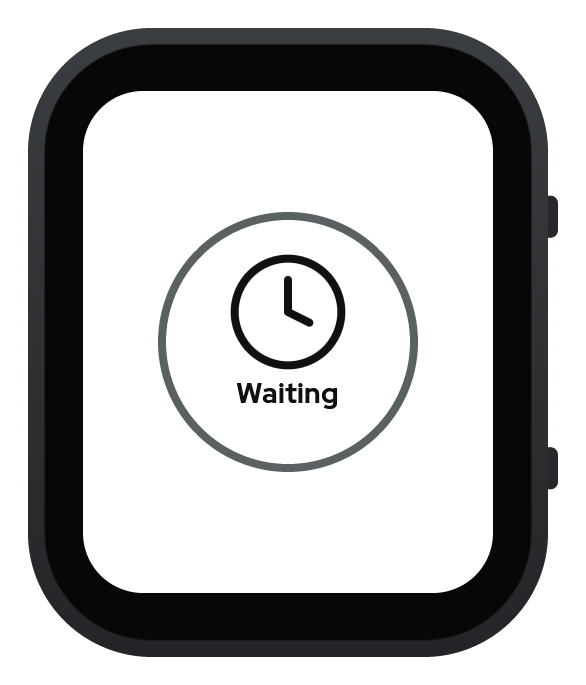

# Tremor log

Tremor log runs a published Parkinson's tremor detector on a watch by itself. Every second the watch runs a C port of the ParaDigMa 1.1.2 tremor detector on the last 4 seconds of gyroscope readings, and the face shows what it found. The face is designed for a person with Parkinson's who wears the watch on the more affected wrist. The watch also reminds the wearer of dose times and logs a dose with one tap.

This is a portfolio project. The detector is used as published and is never retrained. It has been tested on public recordings and on the builder's own wrist, and never on a person with tremor. It gives no basis for dose decisions.

## The face

These screenshots were drawn on the laptop with `firmware/main/face_draw.c` and LVGL 9.5 from a made-up session, then placed in a drawing of the watch case at its real scale.

### Home

The circle shows the latest state. Home keeps the time of the last tremor under it once one has been recorded.

<table>
  <tr>
    <td align="center"><br>Waiting</td>
    <td align="center"><br>Tremor</td>
    <td align="center"><br>Arm moving</td>
  </tr>
  <tr>
    <td align="center"><br>Rest</td>
    <td align="center"><br>Dose due</td>
    <td></td>
  </tr>
</table>

Waiting shows while the detector has no answer yet, such as at the start of a session or after a gap in the readings. Arm moving means the arm moved too much for the detector to judge. Rest means the arm was still and showed no tremor.

### Medication

A tap anywhere on Home opens Medication. The lower half is one large "Took it" button. A tap logs the dose and shows Logged for three seconds, then the face returns to Home. When a dose is due, the next dose line turns purple.

<table>
  <tr>
    <td align="center"><br>Medication</td>
    <td align="center"><br>Dose due</td>
    <td align="center"><br>Logged</td>
  </tr>
</table>

### Session and Status

Session shows the share of still time with tremor in this session. Each block below it covers 10 minutes, and a hollow block had under two minutes of still time. Status lists build details such as the sensor rate, the detector's run time, the firmware version, and the hash of the detector tables.

<table>
  <tr>
    <td align="center"><br>Session</td>
    <td align="center"><br>Status</td>
  </tr>
</table>

The BOOT button cycles through the screens. Every tap target covers at least a third of the screen, and the face uses no swipes or long presses.

## How it works

The watch is a Waveshare ESP32-S3-Touch-AMOLED-2.06. It reads its QMI8658 gyroscope at about 114 readings a second and converts the readings to 100 a second, as the ParaDigMa toolbox does. The C detector follows `reference/plain_detector.py` step for step. It agrees with the toolbox on all 26,264 windows of the 10,318 PADS recordings, with a largest difference of 5.63e-07 in the tremor probability.

When a laptop is plugged in over USB, the watch writes every reading and every answer to it as text. `tools/compare_session.py` then checks each window of a saved recording against the toolbox.

## Repo layout

| Folder | What it holds |
| --- | --- |
| `core/` | The shared C library: the detector, the converter, the state rules, and the replay program. It builds on the laptop and on the watch. |
| `firmware/` | The ESP-IDF project for the watch. `firmware/main/` holds the five tasks and the face. |
| `reference/` | The Python toolbox that the C port must match. |
| `tools/` | Generators for the detector tables and face assets, the watch command tool, and the session check. |
| `tests/` | The C unit tests and the Python checks. |
| `specs/`, `context/` | The mission, tech stack, roadmap, build spec, and face design. |

## Build and check

`make check` builds `core/` and runs the C unit tests, checks the model file's hash, and builds the firmware. The firmware needs ESP-IDF v6.1. `reference/README.md` sets up the Python toolbox and downloads PADS.

To record a session from the watch and check it against the toolbox, after the C build:

```
~/.espressif/tools/python/v6.1/venv/bin/python tools/watch_cli.py record --out session.txt.gz --minutes 60
reference/.venv/bin/python tools/compare_session.py session.txt.gz --report report.md
```

## Status

Features 1 to 11 in `specs/roadmap.md` are done. The recording viewer and the wrist tests with the demo are still to come.

## Credits

- ParaDigMa, Apache 2.0. Timmermans and colleagues, npj Parkinson's Disease, 2025.
- PADS from PhysioNet, non-commercial licence. Varghese and colleagues, npj Parkinson's Disease, 2024.
- KISS FFT, BSD licence.
- Lucide icons, ISC licence.
- Red Hat Display, SIL Open Font Licence.
