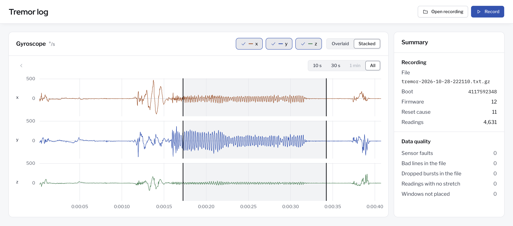

# Recording viewer

`viewer/` holds a small Electron app that plots a saved recording's gyroscope readings against time and marks each stretch where the watch answered tremor. A Summary card at the right of the chart gives the file name and the boot's facts in two groups, Recording and Data quality. In a narrow window it sits under the chart. When the file holds more than one boot, a list above the chart picks the boot. It needs Node 22, and the install needs the network once.



The screenshot shows `tremor-2026-10-28-222110.txt.gz`, a 40-second recording saved from the watch with the Record button, in the stacked layout. The shaking in it did not come from a person with Parkinson's. The file is in `recordings/`, which git leaves out. The screenshot was taken with the viewer's capture mode (`--capture OUT.png --theme light --layout stacked`).

Run these from the repo root.

```
make viewer-start FILE=session.txt.gz
```

`make viewer-start` installs the packages with `npm --prefix viewer ci` when they are missing or out of date, and then runs `npm --prefix viewer start`. Add `BOOT=ID` to open one boot of the file. With no FILE the app opens empty. `make viewer-smoke` runs the app in capture mode on the test recordings and checks each drawing.

File > Open (Cmd+O) opens another recording. The x, y, and z chips show or hide each axis, and the layout control picks Overlaid, one plot of all axes, or Stacked, one plot for each axis. The stacked plots share one scale, so their y labels match, and each names its axis at its left. In every plot, a light grey shade covers each tremor episode, and black vertical lines with no text mark where it starts and ends. Tremor windows that overlap or touch join into one episode. Move the pointer over a plot to read the time, the three values, and the answer at that point. The time span control above the plot shows 10 seconds, 30 seconds, 1 minute, or the whole boot. A span as long as the boot or longer is turned off, since it would show the whole boot. The Earlier button moves the view back by half its width. Drag across a plot to zoom in, double click to show the whole boot, and use the left and right arrow keys to move the view. Every plot shares the view.

The page follows the Mac's light or dark setting. `--theme light` or `--theme dark` after `npm --prefix viewer start --` fixes the theme, and `--layout stacked` opens the file in the stacked layout. `make viewer` runs the viewer's unit tests, which need no install.

The Record button runs `tools/watch_cli.py record`, which resets the watch and saves every line it writes. Press Stop to end the recording, as Ctrl-C does, and the viewer opens the new file. The viewer never opens the watch's port itself. Files go to `recordings/` at the repo root, which git leaves out, with names such as `tremor-2026-10-28-143005.txt.gz`, and a name that is taken gets `-2`. `TREMOR_RECORDINGS` names another folder, and `TREMOR_PYTHON` names the Python to run, which must hold pyserial and is the ESP-IDF Python by default. When the recording cannot start or saves no file, such as when no watch is plugged in, a red notice under the header says why, and the plot stays as it was. When watch_cli.py stops with an error after it saved a file, the viewer still opens that file, and the notice gives the error.
